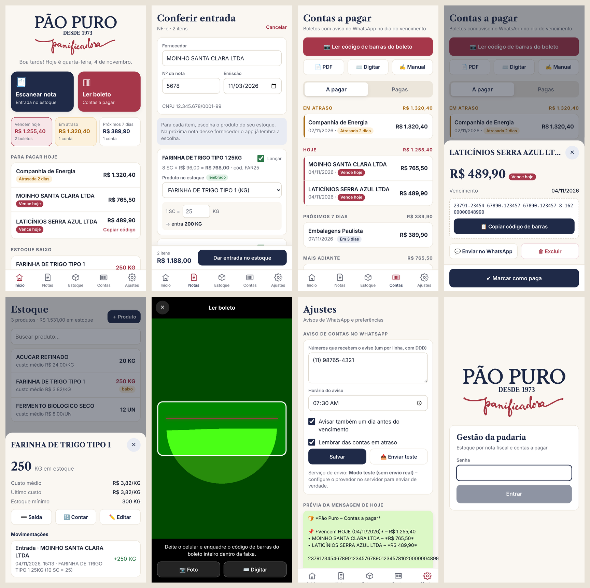

# Pão Puro – App de gestão

App para celular da **Pão Puro Panificadora** com:

- **Entrada de estoque por nota fiscal**
  - QR Code de **NFC-e / cupom fiscal**: o app consulta a SEFAZ e traz os itens sozinho
  - **XML da NF-e** (o arquivo que o fornecedor manda por e-mail): traz itens **e as parcelas (duplicatas)**, que viram contas a pagar
  - Código de barras do **DANFE**: identifica a nota (fornecedor, número) e pede o XML ou o lançamento à mão
  - Lançamento manual
  - O app **lembra** qual produto do estoque corresponde a cada item de cada fornecedor e a **conversão de unidade** (ex.: 1 saco = 25 kg)
  - Custo médio, estoque mínimo, saída e contagem física
- **Contas a pagar**
  - Leitura do **código de barras do boleto** pela câmera, por **PDF** ou digitando a linha digitável
  - Valor, vencimento e banco são extraídos e os dígitos verificadores são conferidos (boleto bancário e de concessionária)
  - Inclui o **novo fator de vencimento** (que reiniciou em 22/02/2025)
  - Bloqueia boleto cadastrado em duplicidade
  - Botão para **copiar o código** e colar no app do banco, e para marcar como paga
- **Aviso por WhatsApp**: todo dia, no horário escolhido, o servidor envia para os números cadastrados a lista das contas que **vencem hoje** (e, se quiser, as de amanhã e as atrasadas)



## Como funciona

```
Celular (app PWA)  ⇄  Servidor Node.js (API + banco SQLite + agendador)  →  WhatsApp
```

O app é um **PWA**: abre no navegador do celular e é instalado na tela inicial como um app comum
(ícone da Pão Puro, tela cheia, sem barra do navegador). Funciona em Android e iPhone. O servidor é necessário
porque o aviso de WhatsApp precisa sair no horário certo mesmo com o celular desligado, e porque a consulta à SEFAZ
não pode ser feita direto do navegador.

> A câmera só funciona em endereço **https://** (ou `localhost`). Hospede o servidor com HTTPS.

## Rodar localmente

Requer **Node.js 22.13+**.

```bash
npm install
npm run build          # instala e gera o app (web/dist)
cp .env.example .env   # edite a senha e o provedor de WhatsApp
npm start              # http://localhost:3000
```

Desenvolvimento com recarga automática: `npm run dev:server` em um terminal e `npm --prefix web run dev` em outro.
Testes dos leitores de boleto/nota: `npm test`.

## Colocar no ar

Qualquer servidor com Node 22 ou Docker serve (Railway, Render, Fly.io, uma VPS com Caddy etc.).
**Prefira um servidor no Brasil**: algumas SEFAZ recusam consultas vindas do exterior.

```bash
docker build -t paopuro .
docker run -d -p 3000:3000 -v paopuro-dados:/data --env-file .env paopuro
```

O banco fica em um único arquivo (`/data/paopuro.db`). Faça backup dessa pasta.

## Configurar o WhatsApp

Escolha um provedor em `WHATSAPP_PROVIDER` no `.env`:

| Provedor | Quando usar | Variáveis |
|---|---|---|
| `meta` | API oficial do WhatsApp Business (mais estável, cobra por conversa) | `META_ACCESS_TOKEN`, `META_PHONE_NUMBER_ID`, `META_TEMPLATE_NAME` |
| `zapi` | Z-API – conecta um número comum pelo QR Code | `ZAPI_INSTANCE`, `ZAPI_TOKEN`, `ZAPI_CLIENT_TOKEN` |
| `evolution` | Evolution API auto-hospedada | `EVOLUTION_URL`, `EVOLUTION_INSTANCE`, `EVOLUTION_API_KEY` |
| `console` | Testes – só escreve a mensagem no log | – |

**Meta:** mensagens iniciadas pela empresa exigem um *modelo* aprovado. Crie um modelo (categoria *Utilidade*), por exemplo:

> 🍞 Pão Puro: hoje vencem {{1}} boleto(s), total {{2}}. {{3}}. Abra o app para copiar os códigos.

Depois, no app, em **Ajustes**: cadastre os números, escolha o horário e toque em **Enviar teste**.
O servidor verifica a cada 5 minutos se já passou do horário e envia **uma vez por dia**.
Se o servidor reiniciar depois do horário, o aviso do dia ainda sai.

## Estrutura

```
server/
  index.js        API REST
  db.js           banco SQLite (node:sqlite)
  alertas.js      montagem e agendamento do aviso diário
  lib/boleto.js   leitura/validação de boletos (usado também no app)
  lib/nfe.js      chave de acesso, XML da NF-e e página da NFC-e na SEFAZ
  lib/whatsapp.js provedores de WhatsApp
web/
  src/pages/      Início, Notas, Estoque, Contas, Ajustes
  src/components/Scanner.jsx  leitor de QR Code / código de barras
  scripts/gerar-icones.mjs    gera logo e ícones a partir da logomarca
```

## Limitações conhecidas

- **Consulta da NFC-e pela SEFAZ:** o leitor entende o layout de consulta pública usado pela maioria dos estados.
  Se a SEFAZ do estado usar outro layout ou estiver fora do ar, o app oferece importar o XML ou lançar à mão.
- **NF-e (modelo 55) pela câmera:** o código de barras do DANFE só traz a chave. Os itens vêm do XML.
  Baixar o XML automaticamente na SEFAZ exige o certificado digital A1 da padaria (pode ser adicionado depois).
- **Boleto de concessionária** (água, luz, telefone) geralmente não traz o vencimento no código; o app pede a data.
- **Leitura do boleto pela câmera:** no Android usa o leitor nativo do Chrome (rápido). No iPhone a leitura é mais lenta;
  use a opção **PDF** ou **Digitar** se demorar.
